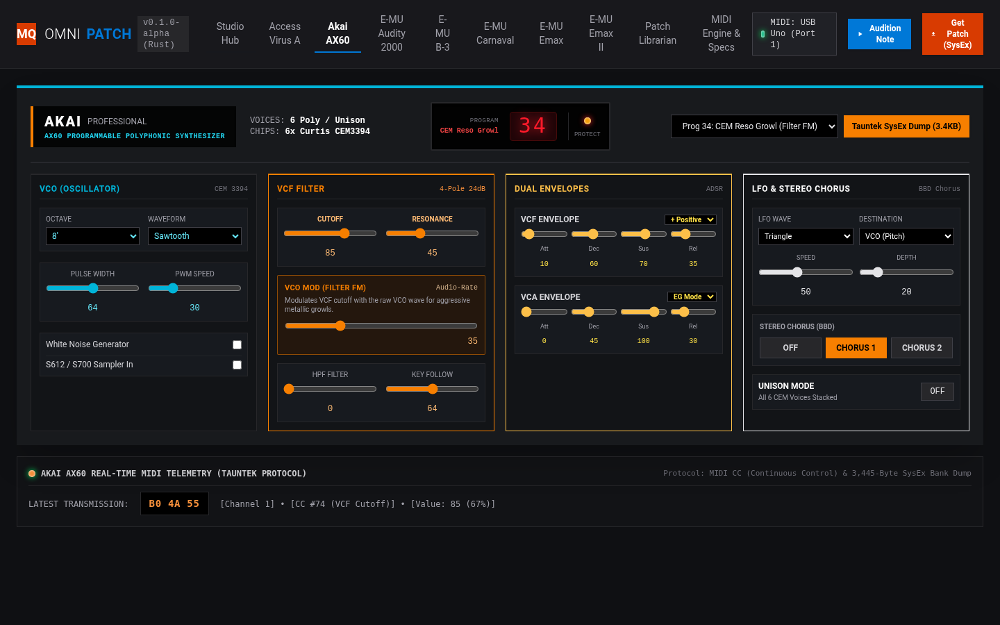
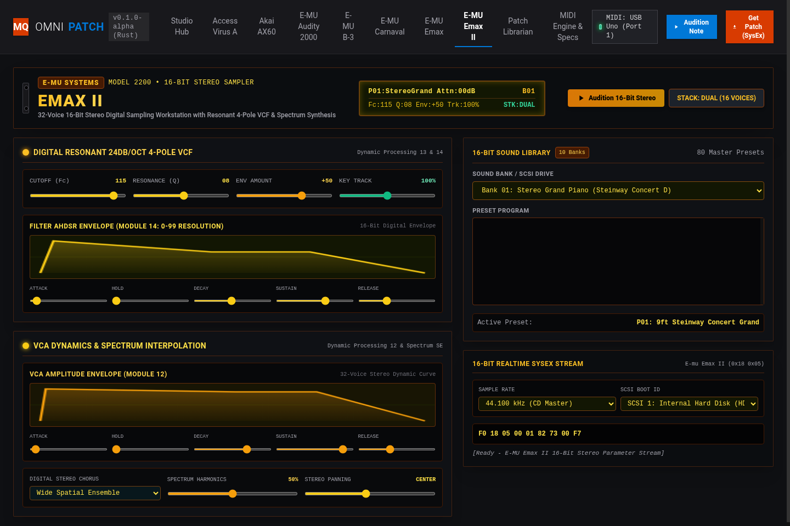
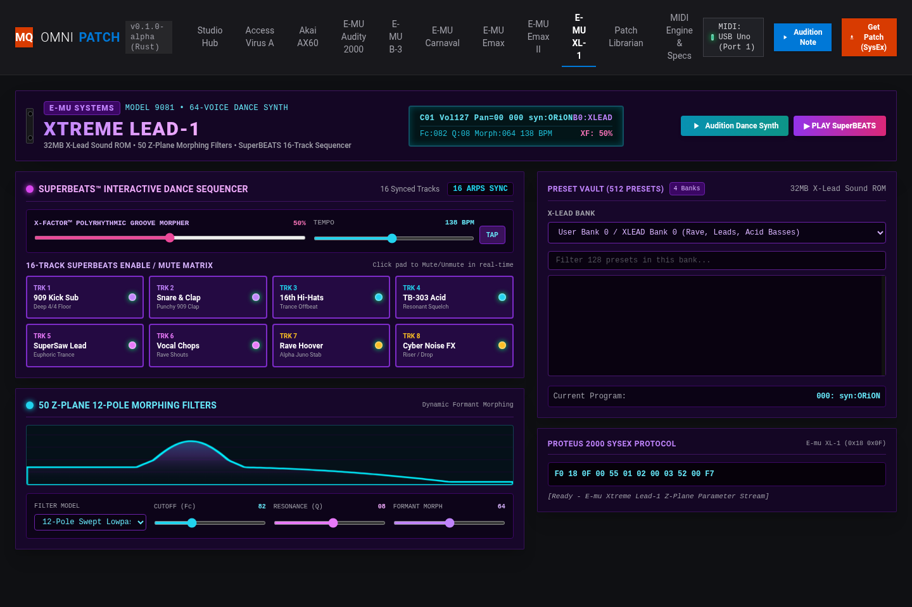
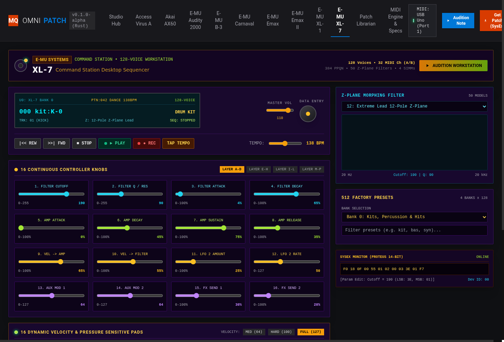

# OmniPatch

> **Universal Cross-Platform MIDI/SysEx Librarian & Patch Editor in Rust**
> Compatible with **Windows, macOS, Linux, FreeBSD, and OpenBSD**.

Inspired by Sound Quest's **Midi Quest 13**, **OmniPatch** combines a clean, fast **Windows 8 Metro / Modern UI** navigation hub with authentic, hardware-tailored skins for vintage analog, virtual analog, and digital rackmount synthesizers.


---

## Features

- **Cross-Platform Rust Core:** High-performance, memory-safe engine running natively across Windows, macOS, Linux, FreeBSD, and OpenBSD.
- **Hardware-Specific Authentic Skins:** Individual hardware modules rendered with real-time reactive displays (vintage LCDs, LED segment displays, rotary knobs, sliders, and canvas spectrum curves).
- **Embedded SQLite Librarian (`rusqlite`):** Fast local patch database storing binary `.syx` blobs, categories, bank indices, and user tags with instant full-text search.
- **Declarative Device Profiles (`.yaml`):** Adding support for a new synthesizer requires zero Rust code changes—just drop a YAML definition file into `devices/`.
- **Vintage Hardware Pacing & Throttling:** Configurable inter-byte and chunk delays to protect vintage 8-bit/16-bit microcontrollers from UART buffer overflow.
- **AI / PDF Manual Ingestion Tool:** Automated PDF extraction utility that scans synth manuals, identifies MIDI Implementation Charts and SysEx tables, and outputs draft profiles.

---

## Supported Synthesizers (Initial Release)

| Synthesizer | Type | Parameters | Presets Loaded | Special Features |
| :--- | :--- | :---: | :---: | :--- |
| **Access Virus A** | Virtual Analog (DSP56303) | 17 | 256 | Multi-page SysEx (Pages A, B, C), 256-byte dumps, 7-bit checksum |
| **Akai AX60** | 6-Voice Polyphonic Analog | 23 | 64 | Curtis CEM3394 engine, Tauntek CC mapping (CC 14–74), 3,445B Bank SysEx |
| **E-MU Audity 2000 (v2)** | 64-Voice Modular Rack | 53 | 640 | 4 Midi Quest modules: MultiMode (16-Ch), Preset Editor, Arp/RPG, Master FX |
| **E-MU B-3** | 64-Voice Tonewheel Organ | 25 | 384 | 9 Hammond Drawbars, Leslie 122 Rotary Cabinet, Harmonic Percussion, Scanner Vibrato |
| **E-MU Carnaval** | 32-Voice Latin & World Percussion | 24 | 640 | BEATS interactive drum machine, X-Factor polyrhythmic groove crossfade, 5 Banks |
| **E-MU Emax** | 12-Bit Analog VCF Sampler | 24 | 72 | SSM2047 24dB/oct resonant analog filters, dual AHDSR envs, dual voice stack, MIDI SDS |
| **E-MU Emax II** | 16-Bit Stereo Workstation | 24 | 80 | 32-voice stereo sampling, digital resonant 4-pole VCF, Spectrum Interpolation, 4-layer stack |
| **E-MU Xtreme Lead-1** | 64-Voice Dance & Techno Synth | 14 | 512 | 50 12-Pole Z-Plane morphing filters, 16-track SuperBEATS sequencer with X-Factor groove, 16-engine poly arpeggiator |
| **E-MU XL-7** | 128-Voice Desktop Workstation | 18 | 512 | 16 Dynamic Velocity/Pressure Pads, 16 Knobs, 16-Track Sequencer (384 PPQN), 50 Z-Plane Filters, 4 SIMMs |

---

## Hardware Editor Screenshots

### Access Virus A (Virtual Analog Synthesizer)


### Akai AX60 (Polyphonic Analog Synthesizer)


### E-MU Audity 2000 (Z-Plane Modular Rack Synthesizer)


### E-MU B-3 (Tonewheel Organ & Leslie 122 Rotary Cabinet)


### E-MU Carnaval (Latin & World Percussion with BEATS Engine)


### E-MU Emax (12-Bit Linear Sampler with SSM2047 Analog VCF)


### E-MU Emax II (16-Bit Stereo Digital Sampling Workstation)


### E-MU Xtreme Lead-1 (Dance & Techno Synthesizer with SuperBEATS)


### E-MU XL-7 (Command Station Desktop Workstation & Sequencer)


---

## Workspace Architecture

```
omnipatch/
├── crates/
│   ├── omnipatch-core/       # SysEx encoding, 7-bit checksums, throttling & timing
│   ├── omnipatch-profile/    # Recursive profile discovery & parameter validation
│   ├── omnipatch-midi/       # Cross-platform MIDI I/O via midir with virtual fallback
│   ├── omnipatch-librarian/  # Embedded SQLite patch database & indexing
│   └── omnipatch-cli/        # Command-line interface for device inspection & SysEx testing
├── devices/                  # Self-contained instrument packages: <manufacturer>/<model>/
│   ├── access/
│   │   └── virus-a/          # profile.yaml, factory_presets.json
│   ├── akai/
│   │   └── ax60/             # profile.yaml, factory_presets.json
│   └── emu/
│       ├── audity-2000/      # profile.yaml, factory_presets.json
│       ├── b-3/              # profile.yaml, factory_presets.json
│       ├── carnaval/         # profile.yaml, factory_presets.json
│       ├── emax/             # profile.yaml, factory_presets.json
│       ├── emax-ii/          # profile.yaml, factory_presets.json
│       ├── xtreme-lead-1/    # profile.yaml, factory_presets.json
│       └── xl-7/             # profile.yaml, factory_presets.json
├── preview/                  # Interactive Metro UI prototype (open in browser)
└── tools/                    # Automated PDF manual ingestion tool (Python)
```

---

## Quick Start

### Build & Test

```bash
# Clone the repository
git clone https://github.com/dan2804/omnipatch.git
cd omnipatch

# Run all unit tests
cargo test

# Build release binaries
cargo build --release
```

### CLI Commands

```bash
# List all loaded synth profiles
./target/release/omnipatch devices list --dir devices/

# Inspect specific synth parameters
./target/release/omnipatch devices show "E-MU XL-7" --dir devices/

# Generate bit-perfect SysEx parameter edit
./target/release/omnipatch sysex param-edit "audity" "0x0144" 95
./target/release/omnipatch sysex param-edit "b3" "0x0180" 8
./target/release/omnipatch sysex param-edit "xl1" "0x0144" 80
./target/release/omnipatch sysex param-edit "xl7" "0x0180" 190

# Import all factory presets into local SQLite librarian
./target/release/omnipatch librarian import-presets --dir devices/ -b library.db

# Search patches by name or category
./target/release/omnipatch librarian search "Deeper Love" -b library.db
./target/release/omnipatch librarian search "Trancer" -b library.db
./target/release/omnipatch librarian search "888" -b library.db
```

### Interactive UI Preview

Open `preview/index.html` in any modern web browser to interact with the **Windows 8 Metro UI Studio Hub** and authentic hardware panels for Access Virus A, Akai AX60, E-MU Audity 2000, E-MU B-3, E-MU Carnaval, E-MU Emax, E-MU Emax II, E-MU Xtreme Lead-1, and E-MU XL-7 Command Station!

---

## License

Open-source under MIT or Apache 2.0.
