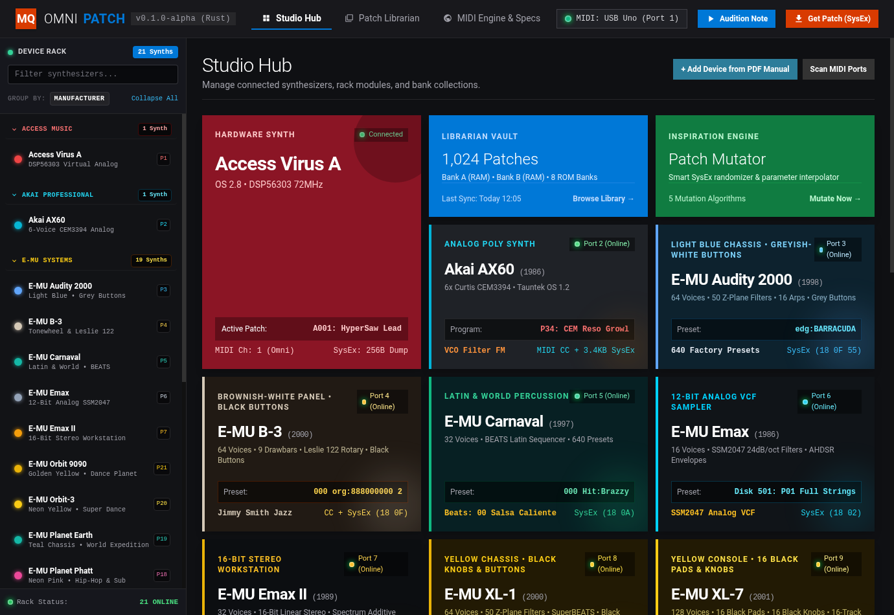

# OmniPatch

> **Universal Cross-Platform MIDI/SysEx Librarian & Synthesizer Patch Editor in Rust**  
> Inspired by Sound Quest's **Midi Quest 13**, crafted with an authentic **Windows 8 Metro UI Modern Studio** experience.  
> Fully compatible with **Windows, macOS, Linux, FreeBSD, and OpenBSD**.

OmniPatch is a high-performance, modular patch librarian and hardware editor written in Rust. It combines a clean, typography-driven **Windows 8 Modern UI** (flat design, zero neon glow, 90-degree geometry, live tiles, collapsible manufacturer menus) with deep hardware-tailored sound engines for 27 legendary vintage analog, virtual analog, phase distortion, and digital rackmount synthesizers.



---

## Key Features

- **Authentic Windows 8 Metro UI Studio:**
  - **Collapsible Manufacturer Menus:** Sidebar hierarchy cleanly grouping instruments under **E-MU Systems**, **Casio Computer Co.**, **Access Music**, and **Akai Professional**, featuring quick `EXP` (Expand All) and `COL` (Collapse All) toggles and auto-reveal on search.
  - **Live Tile Start Screen:** Horizontal Windows 8 panoramic start board with live parameter readouts, family grouping, and quick launch tiles.
  - **Universal Patch Librarian:** Instant cross-synth searching and filtering, live auditioning, and real-time SysEx hexadecimal packet telemetry inspector.
  - **Interactive 2D Filter & Vector Curve Canvas:** Real-time log-frequency response visualization with interactive cutoff and resonance control.
  - **Low-Latency Web Audio Engine:** Reactive auditioning soundboard tiles and interactive synthesizer engines with real-time waveform generation.
- **Cross-Platform Rust Core:** High-performance, memory-safe engine running natively across desktop platforms using `midir` and `rusqlite`.
- **Declarative Device Profiles (`.yaml`):** Adding support for a new synthesizer requires zero Rust recompilation—simply drop a YAML definition file and JSON preset dump into `devices/`.
- **Hardware-Safe Pacing & Buffer Throttling:** Configurable inter-byte and inter-block millisecond delays designed specifically to prevent UART buffer overflows on vintage 8-bit and 16-bit microcontrollers (e.g. Motorola 68000, 6809, and Intel 8031).
- **Embedded SQLite Librarian (`rusqlite`):** High-speed local patch database indexing binary `.syx` blobs, categories, bank indices, ROM IDs, and user tags with instant full-text search.
- **Automated Manual Ingestion Pipeline:** Built-in PDF extraction and NLP utility scans manufacturer service manuals, extracts MIDI Implementation Charts and SysEx specification tables, and generates structured profiles.

---

## Supported Synthesizers (27 Production Profiles)

OmniPatch ships with 27 comprehensive device profiles across 4 legendary synthesizer manufacturers:

| Synthesizer | Manufacturer | Architecture | Parameters | Presets | SysEx ID / Details |
| :--- | :--- | :--- | :---: | :---: | :--- |
| **Access Virus A** | Access Music GmbH | Virtual Analog (DSP56303) | 17 | 256 | `0x10` (16) · Multi-page SysEx (Pages A, B, C), 256-byte dumps |
| **Akai AX60** | Akai Professional | 6-Voice CEM3394 Analog | 23 | 64 | Tauntek CC mapping (CC 14–74), 3,445B Bank SysEx, Sampler input |
| **Casio CZ-1** | Casio Computer Co. | 16-DCO Phase Distortion | 26 | 64 | `0x03` · Dual Line detune, Velocity & Aftertouch sensitivity |
| **Casio CZ-101** | Casio Computer Co. | 8-DCO Portable Phase Distortion | 22 | 32 | `0x01` · Cosine phase distortion, 8-stage DCO/DCW/DCA envelopes |
| **Casio CZ-1000** | Casio Computer Co. | Full-Size 8-DCO Phase Distortion | 22 | 32 | `0x02` · Membrane button styling, 8-stage envelopes, SysEx `0x44` |
| **Casio CZ-230S** | Casio Computer Co. | Phase Distortion + PCM Rhythm | 11 | 100 | `0x04` · 20 PCM rhythm patterns, preset PD voices, onboard speaker |
| **Casio CZ-3000** | Casio Computer Co. | 16-DCO Full-Size Synthesizer | 23 | 64 | `0x05` · Dual line layering, stereo chorus, 8-stage pitch/wave/amp |
| **Casio CZ-5000** | Casio Computer Co. | Flagship PD Workstation | 25 | 64 | `0x06` · Built-in 8-track sequencer, 16 DCOs, dual line stack |
| **E-MU Audity 2000** | E-mu Systems, Inc. | 64-Voice Modular Rack | 53 | 640 | `0x0C` · 4 sub-editors (MultiMode, Presets, Arp, FX), 16 arpeggiators |
| **E-MU B-3** | E-mu Systems, Inc. | 64-Voice Tonewheel Organ | 25 | 384 | `0x0E` · 9 Hammond drawbars, Leslie 122 rotary cabinet, percussion |
| **E-MU Carnaval** | E-mu Systems, Inc. | 32-Voice Latin/World Module | 24 | 640 | `0x08` · BEATS drum machine, X-Factor polyrhythmic groove crossfade |
| **E-MU Emax** | E-mu Systems, Inc. | 12-Bit Analog VCF Sampler | 24 | 72 | `0x00` · SSM2047 24dB/oct resonant analog filters, dual AHDSR, MIDI SDS |
| **E-MU Emax II** | E-mu Systems, Inc. | 16-Bit Stereo Workstation | 24 | 80 | `0x00` · 32-voice stereo sampling, digital 4-pole VCF, Spectrum Interpolation |
| **E-MU Orbit 9090** | E-mu Systems, Inc. | 32-Voice Dance Planet Rack | 7 | 640 | `0x01` · 1996 Golden yellow chassis, Beats mode, 32 digital filters |
| **E-MU Orbit-3** | E-mu Systems, Inc. | 128-Voice Super Dance Module | 7 | 1,024 | `0x11` (17) · Dual 32MB Beat Garden & Techno Yard ROMs, 50 Z-Plane filters |
| **E-MU Planet Earth** | E-mu Systems, Inc. | 64-Voice World Expedition | 7 | 1,024 | `0x06` · Oceanic teal chassis, 32MB World ROM, SuperBEATS engine |
| **E-MU Planet Phatt** | E-mu Systems, Inc. | 32-Voice Hip-Hop / Swing System | 7 | 640 | `0x01` · Magenta anodized chassis, 32 digital filters, BEATS swing grooves |
| **E-MU Proteus 1000** | E-mu Systems, Inc. | 64-Voice 1U Sound Module | 7 | 1,024 | `0x0C` (12) · 30th Anniversary edition, blue trapezoid LCD, 32MB Composer ROM |
| **E-MU Proteus 2000** | E-mu Systems, Inc. | 128-Voice Flagship Module | 8 | 1,024 | `0x04` · 4 ROM slots, 128 voices, 50 Z-Plane filters, 24 mod cords |
| **E-MU Proteus 2500** | E-mu Systems, Inc. | 128-Voice Command Station | 8 | 1,024 | `0x0A` (10) · Desktop console, 16 velocity pads, 16 knobs, 16-track sequencer |
| **E-MU SP-1200** | E-mu Systems, Inc. | 12-Bit 26.04kHz Drum Sampler | 12 | 100 | `0x01` · SSM2044 4-pole discrete analog dynamic filters, 8 multi-pitch sliders |
| **E-MU Vintage Keys** | E-mu Systems, Inc. | 32-Voice Vintage Module (1993) | 10 | 512 | `0x01` · 1U matte steel, 11x5 cyan dot matrix, 8 classic keyboard engines |
| **E-MU Vintage Pro** | E-mu Systems, Inc. | 128-Voice Vintage Workstation | 10 | 1,024 | `0x16` (22) · Two-tone pewter faceplate, 64MB Vintage Collection ROM |
| **E-MU Virtuoso 2000** | E-mu Systems, Inc. | 128-Voice Virtual Orchestra | 10 | 1,024 | `0x08` · 64MB Orchestral Sessions Vol 1 & 2 ROMs, continuous navy wave line |
| **E-MU XK-6** | E-mu Systems, Inc. | 61-Key Dance Performance Synth | 10 | 1,024 | `0x12` (18) · 61 synth-action keys, SuperBEATS interactive engine |
| **E-MU XL-7** | E-mu Systems, Inc. | 128-Voice Command Station | 18 | 1,024 | `0x0E` (14) · Electric yellow desktop tabletop, 16 pads, 16 rotary knobs |
| **E-MU Xtreme Lead-1** | E-mu Systems, Inc. | 64-Voice Dance & Techno Rack | 14 | 1,024 | `0x07` · Electric yellow 1U rack, 50 Z-Plane filters, 16-track SuperBEATS |

---

## Workspace Architecture

```
omnipatch/
├── assets/                   # Hardware faceplate images, vector reference diagrams, icons
│   └── screenshots/          # High-resolution hardware editor & studio screenshots
├── crates/                   # High-performance modular Rust crates
│   ├── omnipatch-cli/        # CLI binary commands, SysEx testing, database utilities
│   ├── omnipatch-core/       # Core types, error handling, parameter schemas
│   ├── omnipatch-librarian/  # SQLite local database storage, indexing, search engine
│   ├── omnipatch-midi/       # midir low-latency packet pacing, hardware throttling
│   ├── omnipatch-profile/    # YAML parser, parameter mapping, validation engine
│   └── omnipatch-sysex/      # Checksum calculators (Roland, E-MU, Casio, Waldorf)
├── devices/                  # 27 Declarative YAML hardware profiles & factory presets
│   ├── access/               # Access Music GmbH (Virus A)
│   ├── akai/                 # Akai Professional (AX60)
│   ├── casio/                # Casio Computer Co. (CZ-1, CZ-101, CZ-1000, CZ-230S, CZ-3000, CZ-5000)
│   └── emu/                  # E-MU Systems (Orbit-3, Proteus family, SP-1200, Emax, Vintage, etc.)
├── preview/                  # Web Audio interactive studio prototypes & hardware editors
│   ├── index.html            # Main Entry: Universal Windows 8 Metro UI Studio Hub (All 27 Synths)
│   ├── metro_studio.html     # Universal Windows 8 Metro UI Studio (Collapsible Menus, Live Tiles)
│   ├── orbit_3_metro.html    # Standalone authentic Metro UI editor for E-MU Orbit-3
│   ├── index_legacy_hybrid.html # Archived backup of legacy skeuomorphic/hybrid rack hub
│   └── *.html                # Dedicated hardware-specific vintage rackface editors
└── tools/                    # Automated PDF manual ingestion tool (Python)
```

---

## Quick Start

### 1. Launching the Interactive Metro Studio

The full 27-instrument Metro Studio can be run locally in any browser with zero installation:

```bash
# Start a local static file server
cd omnipatch
python3 -m http.server 8080

# Open in your web browser:
# http://localhost:8080/preview/index.html
# or
# http://localhost:8080/preview/metro_studio.html
```

#### Metro Studio Features Available Immediately:
- **Collapsible Sidebar:** Expand and collapse hardware brands (E-MU, Casio, Access Music, Akai) or use the `EXP` / `COL` quick buttons.
- **Top Bar Panoramic Navigation:** Switch between **Synth Editor**, **Start Screen**, **Universal Librarian**, and **MIDI Engine & Specs**.
- **Interactive Audio Playback:** Click any preset or soundboard tile to audition real-time synthesis powered by the Web Audio API.
- **SysEx Telemetry:** Inspect live 7-bit MIDI SysEx packet streams and download `.syx` patch dumps directly from the browser.

---

### 2. Building the Rust CLI & Core Engine

```bash
# Clone the repository
git clone https://github.com/dan2804/omnipatch.git
cd omnipatch

# Build the release binaries
cargo build --release

# Run unit tests across all crates
cargo test
```

### 3. CLI Commands & Librarian Usage

```bash
# List all 27 loaded synth profiles
./target/release/omnipatch devices list --dir devices/

# Inspect specific synth parameters
./target/release/omnipatch devices show "Casio CZ-1" --dir devices/
./target/release/omnipatch devices show "E-MU Orbit-3" --dir devices/
./target/release/omnipatch devices show "Access Virus A" --dir devices/

# Generate bit-perfect SysEx parameter edit
./target/release/omnipatch sysex param-edit "cz1" "dco1_wave" 2
./target/release/omnipatch sysex param-edit "orbit3" "cutoff" 105
./target/release/omnipatch sysex param-edit "virus-a" "filter1_cutoff" 88

# Import all factory presets into local SQLite librarian
./target/release/omnipatch librarian import-presets --dir devices/ -b library.db

# Search patches by name, bank, or category
./target/release/omnipatch librarian search "Acid" -b library.db
./target/release/omnipatch librarian search "Strings" -b library.db
./target/release/omnipatch librarian search "Reso" -b library.db
```

---

## Hardware Editor Previews

| Synthesizer | Preview File | Architecture Highlights |
| :--- | :--- | :--- |
| **Universal Metro Studio** | [`preview/index.html`](preview/index.html) | Complete Windows 8 Modern Studio with all 27 synths & collapsible brand menus |
| **E-MU Orbit-3 (Metro UI)** | [`preview/orbit_3_metro.html`](preview/orbit_3_metro.html) | Standalone Windows 8 Metro UI editor, 8 live soundboard tiles, 2D Z-Plane curve |
| **Casio CZ-1** | [`preview/casio_cz_1.html`](preview/casio_cz_1.html) | Flagship 16-DCO Phase Distortion, dual line detuning, velocity/aftertouch |
| **Casio CZ-101 / CZ-1000** | [`preview/casio_cz_101.html`](preview/casio_cz_101.html) | Portable & membrane-keypad PD classics, 8-stage DCO/DCW/DCA envelope engines |
| **Casio CZ-230S** | [`preview/casio_cz_230s.html`](preview/casio_cz_230s.html) | Phase distortion preset soundboard and onboard PCM drum rhythm groove accompaniment |
| **Casio CZ-3000 / CZ-5000** | [`preview/casio_cz_5000.html`](preview/casio_cz_5000.html) | 16-DCO dual line stack, stereo chorus, built-in 8-track hardware sequencer |
| **Access Virus A** | [`preview/virus_a.html`](preview/virus_a.html) | Red anodized chassis, dual resonant serial/parallel filters with saturation drive |
| **Akai AX60** | [`preview/ax60.html`](preview/ax60.html) | Curtis CEM3394 analog sliders, Tauntek CC mapping, stereo BBD chorus |
| **E-MU Proteus 1000 / 2000** | [`preview/proteus_1000.html`](preview/proteus_1000.html) | 30th Anniversary trapezoid LCD, 32MB Composer ROM, 50 Z-Plane filters |
| **E-MU SP-1200** | [`preview/sp1200.html`](preview/sp1200.html) | 12-bit linear 26.04kHz sampler, discrete SSM2044 analog filters, 8-pad decay matrix |
| **E-MU Emax & Emax II** | [`preview/emax.html`](preview/emax.html) | SSM2047 analog VCF vs 16-bit digital processing, spectrum interpolation |
| **E-MU Planet Earth & Phatt** | [`preview/planet_earth.html`](preview/planet_earth.html) | Oceanic teal & magenta anodized 1U racks, World Expedition & Swing System BEATS |
| **E-MU XL-7 & XK-6** | [`preview/xl7.html`](preview/xl7.html) | Desktop tabletop command station & 61-key performance keyboard with SuperBEATS |

---

## License

Open-source under MIT or Apache 2.0.
